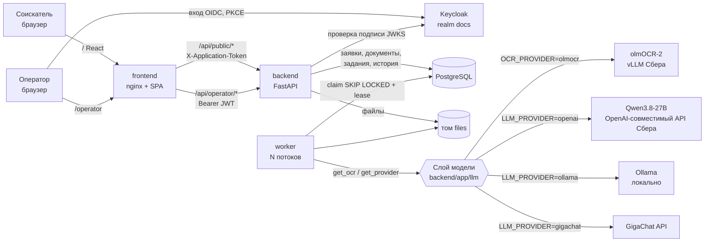

# Архитектура

## Поток обработки документа
1. Соискатель загружает файл → бэкенд проверяет размер, **реальный тип по сигнатуре**, дубликат (sha256), принадлежность
   к выбранному набору → сохраняет файл в том, создаёт `Document(queued)` и `Job(queued)` в одной транзакции → **202** сразу.
2. Воркер забирает задание `SELECT … FOR UPDATE SKIP LOCKED`, ставит аренду (`locked_until`).
3. Стадии документа: `queued → preprocessing → extracting → validating → done | needs_review | unreadable | failed`.
   Каждая стадия сохраняется в БД — интерфейсы показывают честный прогресс.
4. Модель вызывается дважды: определение типа (+ читаемость) и извлечение полей по схеме типа. Затем серверная
   валидация (даты, форматы, обязательность) и итоговая уверенность по каждому полю.
5. Сбой модели → повтор с экспоненциальной задержкой; после исчерпания попыток — `failed` с понятной причиной и
   кнопкой «перезапустить разбор» у оператора.

## Почему работа не теряется при перезапуске
Задание — строка в Postgres, а не сообщение в памяти. Пока задание в работе, отдельный поток продлевает его аренду
каждые 15 с (аренда — 60 с). Если воркер упал, аренда истекает и задание забирает другой воркер; перезапущенный воркер
сразу возвращает в очередь свои незавершённые задания. Загруженные файлы лежат в именованном томе Docker.

Проверено (10.10, реальная модель, 23 файла открытого набора, 8 потоков): приём каждого файла ≤ 80 мс; воркер убит
`kill -9` на 6-й секунде — после перезапуска 8 прерванных разборов продолжились, все 23 документа завершены за 35 с,
потерь нет. Модель недоступна → «временно недоступен, повторим» → после попыток «недоступен» → повторный разбор
оператором → «готово».

## Дубликаты
1. Тот же файл (совпадает sha256) отклоняется при загрузке с понятной причиной.
2. Тот же документ другим файлом (пересохранённое фото, копия) — замечание на уровне документа заявки:
   совпали серия и номер у двух файлов одного вида.

## Безопасность
- Рабочее место оператора: Keycloak (OIDC, Authorization Code + PKCE). Бэкенд на каждом запросе к `/api/operator/*`
  проверяет подпись токена по JWKS, issuer, срок, клиента (`azp`) и роль `operator`. Файлы документов отдаются только так же.
- Соискатель: без регистрации; при создании заявки выдаётся случайный токен (в БД хранится только его хэш).
- Секреты только в `.env` (в git — `.env.example`).
